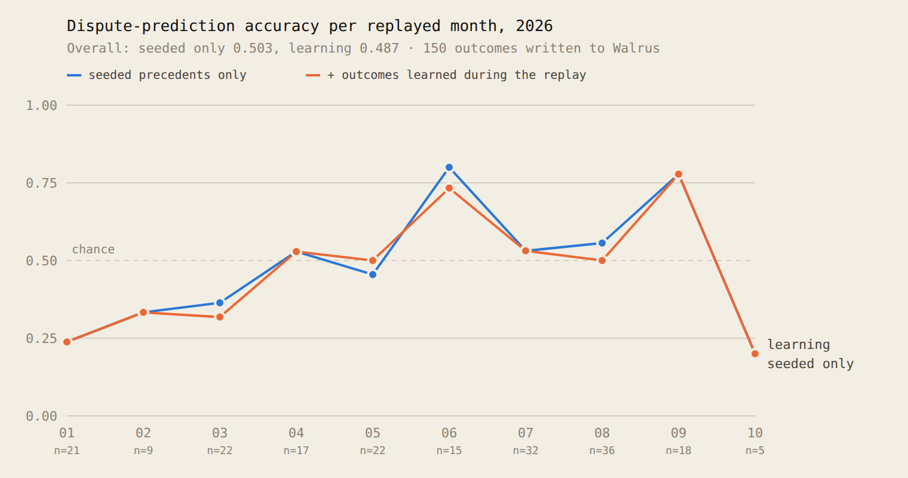

On 1 June 2026, Strategy's 8-K showed that it sold 32 bitcoin in the last week of May. On Polymarket, "MicroStrategy sells any Bitcoin by May 31, 2026?" went from 11c to 81c by 12:12 UTC. From 12:20 it traded between 41c and 82c for 4 hours 39 minutes.

At 17:00:16 UTC the market's owner posted one line to the UMA adapter's bulletin board on Polygon: "Confirmation achieved outside of the market's time frame does not qualify." YES went from 53c at 16:59 to 0.6c at 17:01. The top YES holder says he lost about USD 500k. In July, traders sued.

Here's the part that bothered me. The year before, Polymarket ran "MicroStrategy sells any Bitcoin in 2025?" with the same wording. Its UMA history reads proposed, disputed, proposed, disputed. It resolved NO. Everything a trader needed to know about how this wording behaves at the deadline was already on the record. Nobody puts the record next to the buy button.

So I built Fine Print. You give it a market and it checks the rules against past rulings before you buy.

## What it does

The trader view draws the market's price chart and pins a ruling on it: dispute risk HIGH, MED or LOW, with the past markets it relied on. Each of those is a memory on Walrus, so every citation is a blob ID you can open. Ask about the MSTR market as of 12:20 UTC on 1 June, with only markets that had closed by then, and it rules HIGH and cites the 2025 market.

Bots get the same ruling over HTTP. `GET /api/ruling?market=<id>` answers 402. The bot pays 0.02 USDC with x402, signing a gasless transfer the server settles on Sui, and gets the ruling back. If a LOW ruling is followed by a dispute, the fee goes back to the bot. Here is the demo bot on the 1 June replay:

```
BUY YES @0.81  replay 2026-06-01 12:20 UTC: 8-K shows 32 BTC sold
  → GET /api/ruling?market=2169995  402 Payment Required
  → paid 0.020 USDC  https://suiscan.xyz/testnet/tx/HuhiDVBofD5aGQcfjxozACdvoRmtDXm2vijdFF53Dvka
  → ruling HIGH (p=0.72) citing market 516926 blob xPylFoZWSadMKzBSaPOlSbsX11Vu0s8NVzpbxLVMW0s
  → SKIPPED
```

The chart also shows which version of the rules you bought under. For the MSTR market, the chain holds three: the rules as created on 5 May, a notice at 14:13 UTC on 1 June saying a clarification might come at 1 PM ET, and the clarification itself at 17:00:16.

## How Walrus Memory is used

Everything the court knows lives in Walrus Memory on Sui mainnet, split across three MemWal accounts. PRECEDENTS holds one memory per resolved market: its riskiest clause, its resolution source, the crowd's price 24 hours before close, its UMA status sequence and its outcome. It also holds ten wording patterns with their dispute counts. COURT holds every ruling, sealed before the market resolves, and later its grade. USER holds rule versions, one memory per version.

I seeded 401 precedents, half of them disputed, including the 2025 MSTR twin. Recall is semantic only, so the close date is written into each memory's text and the leakage guard throws out anything that closed after the ruling's "as of" time. Accounts and delegate keys were created with gas sponsored by the Walrus Memory relayer, the same way its playground does it, so the memory side cost nothing.

## How Tatum is used

Tatum's Prediction Market API gives the rules, outcomes and minute price history. For resolved Polymarket markets the default history source came back empty, but the `midpoint` source had every minute, and that's what draws the demo chart.

Tatum's Polygon RPC reads the UMA adapters' bulletin board. That's how I found the 17:00:16 clarification on-chain, posted the same minute the price collapsed, along with the two `DisputePrice` events on the market. It also rebuilds rule lineages for markets Fine Print wasn't watching.

Tatum's Sui GraphQL gateway settles and re-checks every payment. I started on gRPC, but Tatum's Sui gRPC endpoint speaks native gRPC, which the fetch-based client can't use from Node or a Cloudflare Worker, and the JSON-RPC endpoint now returns 404. GraphQL worked with the same client API.

## Did memory help?

I tested this on 200 markets that closed in 2026 and that the court had never seen, half of them disputed. Same model, three conditions, one change at a time: rule text only, then precedents from Walrus, then wording patterns with their dispute counts on top. A market only sees precedents that closed before it was created.

| Condition | Accuracy | F1 |
|---|---|---|
| Rule text only | 0.510 | 0.160 |
| + precedents | 0.497 | 0.275 |
| + patterns (Fine Print) | 0.492 | 0.191 |

Rule text and Fine Print are the mean of three runs; the precedents-only condition ran once.

Memory doesn't help on average. It makes the court flag more disputes, so recall of disputed markets goes up, but precision drops with it, and accuracy stays near a coin flip. The reason is visible in the recall itself. For disputed test markets, 46% of the recalled precedents were disputed. For clean test markets, 44%. Semantic search finds markets that look alike, and most look-alikes are the same template (every NBA game resembles every other NBA game), not the same risk.

The lift shows up where the wording itself is the risk. Across 159,502 markets that closed before 2026, 0.47% were disputed. Markets with the MSTR pattern, a deadline plus a confirmation that can arrive after it, were disputed 3.5% of the time. On the 12 test markets with that pattern, accuracy went from 0.417 on rule text to 0.667 with precedents. Twelve markets is a hint, not a result.

I also replayed a news-spike bot that buys $100 of YES on the first sharp rise. It loses money on these markets whatever you do (spikes before a dispute are bad entries), Gated by Fine Print it lost -$7,050, against -$7,196 gated by rule text and -$7,260 ungated, over 120 trades net of fees. That gap is small: the gate skipped 7 losing trades and 7 winning ones.

## How it learned over time

To test whether the court gets better as case law piles up, I replayed 2026 in order. Each test market was ruled three days before it closed (or when it opened, if later), using only precedents that had closed before that moment. After each month, the outcomes of test markets that closed that month were written to Walrus on mainnet, 150 in all, so later months could recall them. Two courts ruled every market side by side: one with only the seeded precedents, one that also saw what it had learned.



It didn't learn its way to better calls. Over 197 rulings each, the court with only seeded precedents scored 0.503 and the learning court 0.487. Learning changed the verdict on 60 markets, 51 of them citing a precedent it had just written. Most of those were LOW to MED or back, which doesn't change the call. 21 changes flipped the call itself: 9 from wrong to right and 12 from right to wrong. Both lines climb through the year together, which tells you the climb comes from the mix of markets in each month, not from memory.

When the court did change its mind, both rulings were sealed on Walrus, so each change is checkable: the old ruling, the precedent that moved it, and the new ruling, all by blob ID. 49 of them are on the memory page of the app.

## What didn't work

The lead-time test was a flat negative. Of 32 disputed test markets where the price spiked before a cliff, the court flagged none of them HIGH at the spike.

A rule-change alert on its own couldn't have saved the MSTR holder either. The clarification and the reprice happened in the same two minutes. The only usable window was before the buy.

Payments run on Sui testnet. Memory, precedents, rulings and rule versions are on mainnet, but I chose not to spend money on this entry. Switching payments to mainnet is one setting and a funded wallet. In a 50-call soak test, 42 paid calls went through end to end; the other 8 were connection failures on my machine before any payment, and the server shows no payment without a ruling.

An early version of the grader graded two rulings I made in November on the long-resolved MSTR market and wrote its outcome back as a precedent twice. Grading now only counts rulings made before a market closes. Walrus is append-only, so those memories are still there; the evaluation recalls only the seeded pool, so they don't touch the numbers.

## Try it

The app is at https://fineprint.prashantthakur.dev and the code at https://github.com/Prashant-thakur77/FinePrint. Every number in this post comes from a script in the repo, listed with its command in `eval/REPORT.md`.
